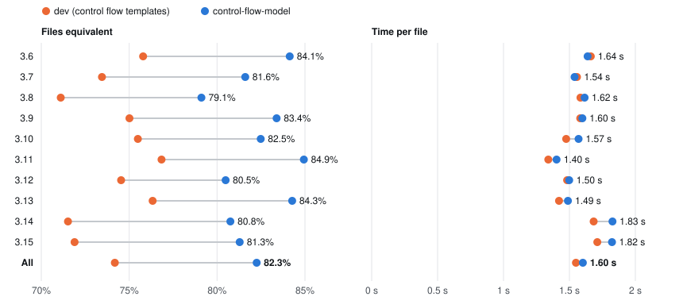

# PyLingual - Python Decompiler for 3.6+

PyLingual is a CPython bytecode decompiler supporting all released Python versions since 3.6. For information about the design and implementation of PyLingual, please refer to our [research paper](https://www.computer.org/csdl/proceedings-article/sp/2025/223600a052/21B7QZB86cg).

PyLingual can be run through our [web service](https://pylingual.io) or run locally.

This codebase is optimized for readability and future extension, so there may initially be some control flow accuracy regression compared to the version hosted on the web service.

## Requirements

- `uv` Python package manager ([installation](https://docs.astral.sh/uv/getting-started/installation/)), used for project dependencies and managed Python versions.

### Decompiling End-Of-Life Python Versions

To verify decompilation correctness and produce model training sets, PyLingual requires the ability to compile Python in the target version.

For current Python versions (3.8-3.15), PyLingual uses `uv`'s managed installations, but for Python 3.6 and 3.7, PyLingual uses [pyenv](https://github.com/pyenv/pyenv) ([pyenv-win](https://github.com/pyenv-win/pyenv-win) for Windows).

## Setup

Install from source, using [uv](https://docs.astral.sh/uv/):

```sh
git clone https://github.com/syssec-utd/pylingual
uv tool install ./pylingual
```

### Redis translation cache (optional)

The CLI can reuse translation-model predictions across files and runs using Redis,
with the same cache used by [the dataset evaluator](https://github.com/syssec-utd/pylingual_eval_dataset).
Entries are keyed by Python version and normalized bytecode. Repeated statements can
skip translation-model inference; the first uncached translation still runs the model,
and segmentation and model loading are not cached by Redis.

With Docker and Docker Compose installed, start Redis from the cloned repository:

```sh
cd pylingual
docker compose up -d redis
```

The bundled service listens on `127.0.0.1:6379`. If Redis is already running there
(for example, for the dataset evaluator), reuse it instead of starting another service.
Enable caching with:

```sh
pylingual --redis-host 127.0.0.1 example.pyc
```

Alternatively, set `PYLINGUAL_REDIS_HOST`: `export PYLINGUAL_REDIS_HOST=127.0.0.1`
in a POSIX shell, or `$env:PYLINGUAL_REDIS_HOST = '127.0.0.1'` in PowerShell.
Without a host, Redis caching remains disabled. Use `--redis-port` or
`PYLINGUAL_REDIS_PORT` for a different port; the CLI defaults to `6379`.
Command-line settings override their environment variables.

Cache keys do not include the translation model revision. Use a separate Redis
instance when switching translation models to avoid reusing predictions from another model.

## Usage

```
Usage: pylingual [OPTIONS] [FILES]...

  End to end pipeline to decompile Python bytecode into source code.

Options:
  -o, --out-dir PATH      The directory to export results to.
  -c, --config-file PATH  Config file for model information.
  -v, --version VERSION   Python version of the .pyc, default is auto
                          detection.
  -k, --top-k INT         Maximum number of additional segmentations to
                          consider.
  -r, --redis-host HOST  Redis translation cache host; defaults to
                         $PYLINGUAL_REDIS_HOST. Unset disables caching.
  --redis-port PORT      Redis port; defaults to $PYLINGUAL_REDIS_PORT
                         or 6379.
  -q, --quiet             Suppress console output.
  --trust-lnotab          Use the lnotab for segmentation instead of the
                          segmentation model.
  --init-pyenv            Install pyenv before decompiling.
  -h, --help              Show this message and exit.
```

Control flow is reconstructed by a control flow model, the `CONTROL_FLOW_MODEL` of the config file; see
`dev_scripts/README.md` for training one.

## Benchmark

End to end against `dev` at [`aca827d`](https://github.com/syssec-utd/pylingual/commit/aca827d), which uses control
flow templates, on the PyLingual v1 and v2 evaluation sets: 65,119 `.pyc` files across Python 3.6–3.15. A file counts
as equivalent only if every code object in it recompiles to equivalent bytecode in a fresh interpreter of its version.
Each arm used the models its own config names. Both ran on the same RTX 4090s, alternating which arm went first on each
chunk of files, with a 300 s timeout per file.

<picture>
  <source media="(prefers-color-scheme: dark)" srcset="docs/benchmark-vs-dev-dark.svg">
  
</picture>

| Python | Files | dev | Control flow model | Δ pp | Files gained / lost | dev, per file | Control flow model, per file | Time |
|---|---:|---:|---:|---:|---:|---:|---:|---:|
| 3.6 | 5,886 | 75.79% | **84.13%** | +8.34 | +500 / −9 | 1.66 s | **1.64 s** | 0.99× |
| 3.7 | 6,147 | 73.45% | **81.60%** | +8.15 | +510 / −9 | 1.56 s | **1.54 s** | 0.99× |
| 3.8 | 6,271 | 71.11% | **79.11%** | +8.01 | +513 / −11 | **1.58 s** | 1.62 s | 1.02× |
| 3.9 | 6,188 | 75.02% | **83.39%** | +8.37 | +534 / −16 | **1.58 s** | 1.60 s | 1.01× |
| 3.10 | 6,252 | 75.50% | **82.49%** | +6.99 | +471 / −34 | **1.48 s** | 1.57 s | 1.06× |
| 3.11 | 6,326 | 76.84% | **84.94%** | +8.09 | +559 / −47 | **1.34 s** | 1.40 s | 1.05× |
| 3.12 | 6,324 | 74.54% | **80.49%** | +5.95 | +426 / −50 | **1.48 s** | 1.50 s | 1.01× |
| 3.13 | 7,750 | 76.34% | **84.27%** | +7.94 | +657 / −42 | **1.42 s** | 1.49 s | 1.05× |
| 3.14 | 6,906 | 71.52% | **80.76%** | +9.24 | +667 / −29 | **1.68 s** | 1.83 s | 1.08× |
| 3.15 | 7,069 | 71.89% | **81.28%** | +9.39 | +693 / −29 | **1.71 s** | 1.82 s | 1.07× |
| **PyLingual v1 eval** | 49,591 | 85.96% | **90.18%** | +4.22 | +2,262 / −170 | 1.01 s | **1.01 s** | 1.00× |
| **PyLingual v2 eval** | 15,528 | 36.57% | **56.94%** | +20.36 | +3,268 / −106 | **3.28 s** | 3.50 s | 1.07× |
| **All** | 65,119 | 74.19% | **82.25%** | +8.07 | +5,530 / −276 | **1.55 s** | 1.60 s | 1.03× |

Files whose output fails to compile drop from 8,271 to 3,928. By the first compile error, block structure errors
(unexpected indents, orphaned `except`/`else`/`elif`/`finally`, `break`/`continue` outside a loop) go from 4,339 files
to 6; the rest come from statement lines and are about the same in both arms.

## Demo


## Support

If you have any issues for installing and using PyLingual, please create an issue or send your message via our support email at pylingual.io@gmail.com.
